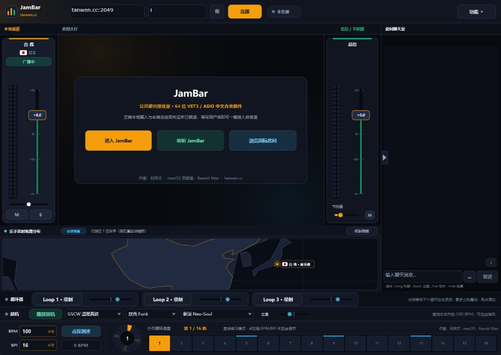
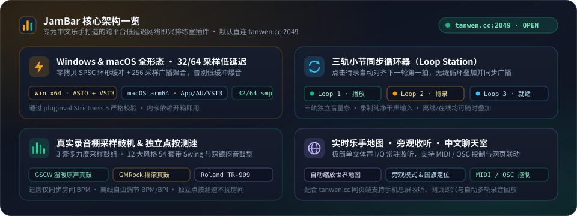

# 🎸 JamBar

**中文版 64 位跨平台实时网络即兴排练室插件（VST3 / AU / ASIO 独立桌面版）**

**作者：何岸文** · **macOS 贡献者：Bassist Max**
🌐 官方排练室主页 & 实时收听 / 录音回放：**[https://tanwen.cc](https://tanwen.cc)** · 默认公开房间：`tanwen.cc:2049`

 

---

**JamBar** 是一款专为中文乐手打造的跨平台网络即兴排练室插件（支持 **Windows 64 位 VST3 / ASIO 独立版** 与 **macOS Apple Silicon VST3 / AU / 独立 App**），界面采用与 [tanwen.cc](https://tanwen.cc) 一致的深邃夜空暗色设计语言，开箱直连公开排练室，也支持离线配合鼓机与三轨循环器日常练琴。

  

## ✨ 核心特性

- **Windows & macOS 全形态支持**
  - **Windows x64**：原生 64 位 VST3 插件（通过 `pluginval` Strictness 5 严格校验）+ 内置 Steinberg ASIO 驱动的独立桌面版 `JamBar.exe`；
  - **macOS arm64 (Apple Silicon)**：原生 VST3、Audio Unit (`JamBar.component`) 与独立桌面版 (`JamBar.app`)，内嵌 `libcrypto.3.dylib` 开箱即用（感谢 **Bassist Max** 贡献 macOS 适配与打包方案）。
- **低延迟 32 / 64 采样深度优化**
  - 音频线程采用零拷贝原位 SPSC 环形写入与 256 采样广播聚合缓冲，彻底解决低于 128 采样缓冲（32 / 64 采样）下的队列溢出与爆音杂音问题。
- **三轨小节同步循环器（Loop Station）**
  - 配备 **Loop 1 / Loop 2 / Loop 3** 三个独立按钮与独立音量条，最多支持三轨同时叠加播放；
  - 点击任意 Loop 按钮即进入「待录」状态，自动从**下一个循环的第一拍**精准开始录制干声乐器输入，循环结束自动停止并无缝循环播放（本地可听且同步广播至房间）；再次点击即清空并停止该轨。
- **内置真实录音棚采样鼓机 & 独立点按测速**
  - 内置 **3 套多力度分层真实采样鼓组**自由切换：**GSCW 温暖原声真鼓**（Yamaha + CustomWorks + Sabian AAX）、**GMRock 摇滚真鼓**（Hydrogen GPL-2.0）、**Roland TR-909 电子鼓**；
  - 涵盖 **12 大风格共 54 套带 Swing 律动与真实闭踩镲闷音（Choke）的鼓型**，声音直接注入本地输入；进房时**仅同步房间 BPM**，离线时可自由修改本地 BPM / BPI 配合鼓机与循环器练习；
  - 底部自带独立 **「点按测速」** BPM 测速器，手动点击即时测速，3 秒无点击自动归零，不干扰房间 BPM。
- **极简单立体声输入/输出与常驻监听**
  - 单一立体声输入 + 单一立体声输出（单声道自动双声道监听），左侧常驻本地通道、右侧常驻总控与节拍器，未进房间与旁观时均可实时监听。
- **现代极简交互、旁观模式 & 自动缩放世界地图**
  - 欢迎页三按钮一键直达、国际房间大厅自动过滤机器人人数、旁观实时显示在线乐手国旗与国家/地区、底部自动缩放世界/中国地图、首小节同步等待倒计时提示、完整中文聊天室与 MIDI/OSC 控制。

## 📦 下载与安装

前往 **[GitHub Releases](https://github.com/KeenyHo/JamBar/releases/latest)** 或官方主页 **[https://tanwen.cc](https://tanwen.cc)** 下载对应平台安装包：

| 平台 | 安装包 | 包含形态 | 安装路径 / 使用方式 |
| :--- | :--- | :--- | :--- |
| **Windows (64 位)** | `JamBar-Windows-x64-VST3.zip` | 独立桌面版 (`JamBar.exe`) 64 位 VST3 (`JamBar.vst3`) | 独立版双击运行并在音频设置选择 **ASIO** 声卡； VST3 复制到 `C:\Program Files\Common Files\VST3\` |
| **macOS (Apple Silicon / arm64)** | `JamBar-macOS-arm64.zip` | 独立桌面版 (`JamBar.app`) AU (`JamBar.component`) VST3 (`JamBar.vst3`) | 独立版直接运行（如遇未公证提示，请在系统设置「隐私与安全性」点击「仍要打开」）； AU 复制到 `~/Library/Audio/Plug-Ins/Components/`； VST3 复制到 `~/Library/Audio/Plug-Ins/VST3/` |

## 🎛 推荐搭配工具

- **[声核 (audcore)](https://github.com/audcore/audcore-document)** — 免费、超轻量（毫秒级启动、极低 CPU 与内存占用）的 Windows ASIO 实时 VST3 调音台与效果器机架。不想打开笨重 DAW 时，推荐直接用「声核」挂载吉他箱头/人声效果链与 `JamBar.vst3`，自由路由监听通道并实现超低延迟合奏。

## 🌐 官方在线排练室

- **公开服务器地址**：`tanwen.cc:2049`（免密匿名加入，8 席位公开即兴）
- **网页端主页**：[https://tanwen.cc](https://tanwen.cc) — 支持网页实时收听（含手机息屏后台播放）、网页开麦加入演奏、双向实时聊天、自动混音波形回放与 REAPER 多轨工程导出。

## 📚 更多文档与独立模块源码

- 📖 [**更新日志（CHANGELOG）**](./CHANGELOG.md) · ❓ [**常见问题排查（FAQ）**](./FAQ.md) · 💬 [**问题反馈（Issues）**](https://github.com/KeenyHo/JamBar/issues)
- 🧩 [**独立音频模块参考源码（`modules/`）**](./modules/README.md)：已公开自研的 **真鼓采样鼓机（`DrumMachine`）** 与 **三轨同步循环器（`LoopStation`）** 无锁实时音频引擎源码供交流学习。

## 📄 开源协议与完整源码获取

本项目遵循 **GNU General Public License v2.0 (GPL-2.0)**（详见 [LICENSE](./LICENSE)）。

- 本公开仓库用于托管 **JamBar 官方文档、正式跨平台安装包（Releases）、Issues 社区反馈以及部分独立音频模块源码**；
- 为避免未经授权的二次打包与恶意篡改，完整编译工程暂存于私有仓库。依据 GPL-2.0 协议，如需获取对应发布版本的完整对应源码，请通过本仓库 [**Issues**](https://github.com/KeenyHo/JamBar/issues) 或访问 **[https://tanwen.cc](https://tanwen.cc)** 联系作者 **何岸文**，我们将按协议免费提供。
